<div align="center">

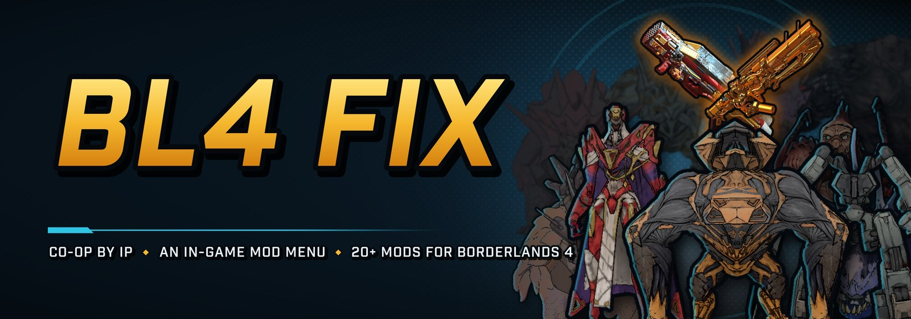

[](https://github.com/flameaway/bl4-fix/releases/latest/download/BL4FixSetup.exe)
[](#install-without-the-setup-app)

[](https://github.com/flameaway/bl4-fix/releases/latest)
[](https://github.com/flameaway/bl4-fix/releases)
-orange)


[Install](#install) •
[Mods](#the-mods) •
[Co-op](#bl4-direct-connect-co-op-by-ip) •
[Keys](#keys-at-a-glance) •
[Updates](#updates) •
[Safety](#safety) •
[FAQ](#faq-and-known-limitations) •
[Development](#for-developers)

</div>

---

<p align="center">
  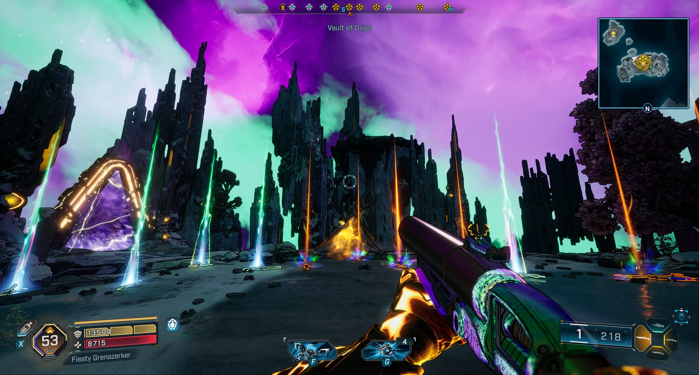
</p>

## Why BL4 Fix?

- **Play co-op with friends by IP address.** No SHiFT party or Steam invite needed: one player
  hosts, friends join from an in-game panel. Enemies also move far more smoothly on your friends'
  screens than in the game's own co-op.
- **One installer for everything.** It finds your game, installs the Python SDK and the mods you
  tick, sets up the firewall, and prepares every page the mods change before your first launch.
- **Settings inside the game.** Every mod's options and keys are on one **MODS** screen (F7, the
  pause menu or the title screen), built from the game's own menus.
- **Built to cost nothing.** Every mod is held to a strict frame-time budget (no per-frame work
  when it isn't needed, nothing heavy on the game thread). There's even a mod that removes some
  of the game's own hitches.
- **Safe to remove.** Every mod puts back what it changed when you switch it off. The installer
  never writes your save files, and its mods step aside on their own after a game patch until
  they've been updated.
- **Updates itself.** The Mod Menu checks for new versions once per launch and installs them
  when the game closes.

## Install

You need Borderlands 4 on Windows (Steam or Epic). The setup app brings everything else.

1. **[Download `BL4FixSetup.exe`](https://github.com/flameaway/bl4-fix/releases/latest/download/BL4FixSetup.exe)**
   and close Borderlands 4.
2. Run it. It finds your Borderlands 4 install (Steam or Epic).
3. Tick the mods you want (all are ticked on a first install) and press **Apply**.
4. Launch the game. Press **F7**, or pick **MODS** in the pause menu or on the title screen, to
   change any mod's settings and keys.

<p align="center">
  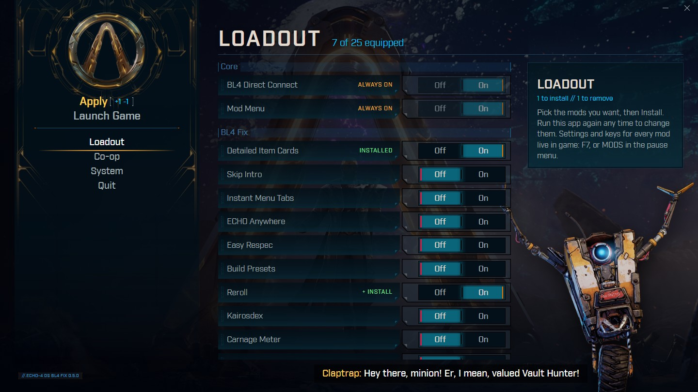
</p>

The setup app:

- installs the Microsoft VC++ runtime if it's missing, and the pinned Python SDK
  ([oak2-mod-manager](https://github.com/bl-sdk/oak2-mod-manager) 0.3);
- installs **BL4 Direct Connect** and the **Mod Menu** (always on) plus every mod you ticked,
  already enabled;
- sets up the BL4 UI Link (one small shared pak that runs the mods' page scripts without
  replacing any game page), so item cards, the MODS screen and the co-op page work on your
  first launch;
- offers a Windows Firewall rule so that only friends you've added can reach a game you host
  (**Firewall rule for hosting**: off unless you turn it on, strongly recommended if you host);
- adds **Start menu > BL4 Fix Setup**, so you can come back any time to add or remove mods,
  repair, manage friends or uninstall;
- checks GitHub for a newer release each time it starts: **Update App** at the top of its menu
  downloads the new version, replaces itself and restarts (your mods, friends and settings stay);
- has an optional **Disk Space** page, never part of Install: it removes the voice languages you
  don't use (Steam installs all 8, ~9 GB each) and blanks the old patch data the game never reads
  (NTFS sparse files). Keeping English, it finds 133 GB of a 190 GB install. Undo with
  Steam's **Verify integrity of game files**; scan again after a game update.

<details>
<summary><b>More of the setup app</b> (Co-op, System, finished install)</summary>
<br>

| Co-op: your IP, friends and the firewall | System: health check, repair and uninstall |
|:---:|:---:|
| 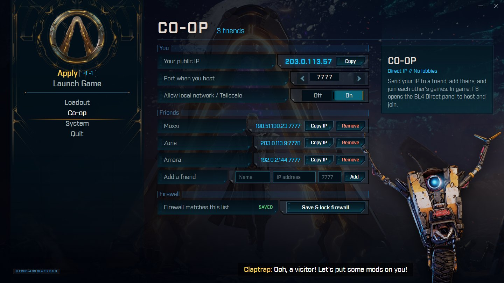 | 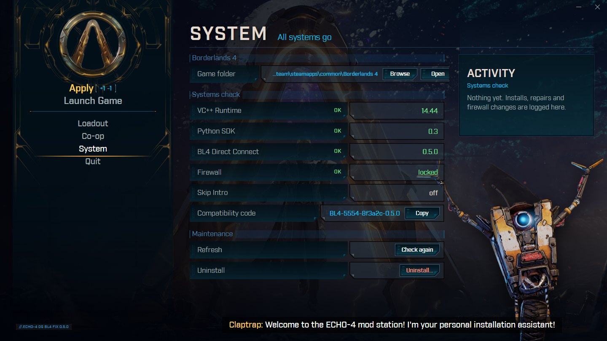 |

<p align="center">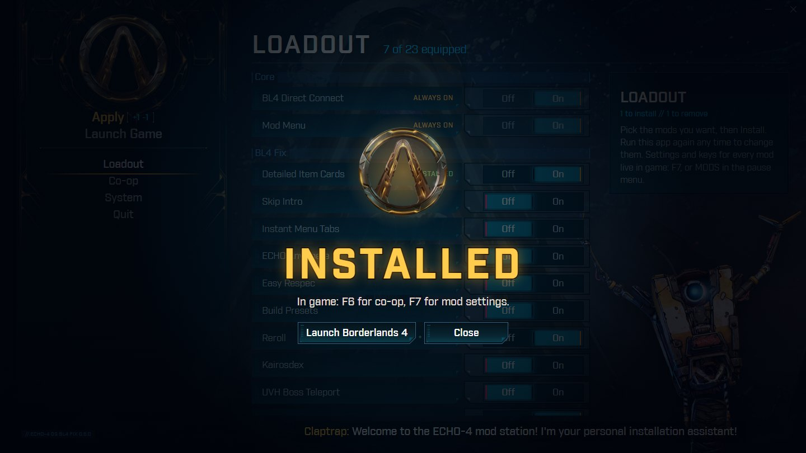</p>

Command line: `BL4FixSetup.exe --list-mods`, `--mods <ids>`, `--add-mod <id>`,
`--remove-mod <id>`, `--prepare-pages`, `--disk-scan [--keep <languages>]`,
`--disk-free --keep <languages>|all [--old-patches on|off]`.

</details>

### Install without the setup app

Rather not run an exe? Every release also has **[`BL4Fix-Manual.zip`](https://github.com/flameaway/bl4-fix/releases/latest/download/BL4Fix-Manual.zip)**:
the same mods, the pinned Python SDK, the page files the setup app prepares and Kairosdex's boss
and item pictures, with no program
to run. Each `.sdkmod` inside is a zip of readable Python. GitHub rebuilds the zip from the source
code and attests it, so you can check it's exactly what this repository builds (see
[Checking a download](#checking-a-download)).

1. Close Borderlands 4.
2. Extract everything in the zip into the game folder, the one with `OakGame` in it (Steam:
   right-click the game > **Manage** > **Browse local files**). Say yes to replacing files.
3. Launch the game. Every mod starts switched on; switch off the ones you don't want on **MODS**
   (F7). Kairosdex's pictures are already in place: nothing downloads on the first launch.

What the setup app does that the zip leaves to you:

- **Visual C++ runtime:** the SDK needs a recent one. Most PCs have it from other games; if no mod
  shows in game, install [Microsoft's x64 runtime](https://aka.ms/vs/17/release/vc_redist.x64.exe).
- **Firewall rule for hosting:** BL4 Direct Connect's page (F6) offers it.
- **Old copies:** another mod loader's `OakGame/Binaries/Win64/dsound.dll`, or old mod folders
  `sdk_mods/bl4_<name>/` (they win over the `.sdkmod` files): remove them.
- **Updates:** **MODS > Updates** in game, or extract a newer zip the same way (your settings are
  kept: the zip has no `sdk_mods/settings/`).
- **Uninstall** (game closed, after switching off Skip Intro in game so the logo movies come
  back): delete `sdk_mods/bl4_*.sdkmod`, `OakGame/Content/Paks/~mods/BL4Fix_UILink_4251_P.pak` and
  the `bl4*` folders in `OakGame/Content/uiresources/`. For the SDK too, `OakGame/Binaries/Win64/dsound.dll`
  and `OakGame/Binaries/Win64/Plugins/`. Or run the setup app's **System > Uninstall** any time.

The zip's `BL4Fix-README.txt` has the same steps.

## Keys at a glance

Every key can be changed on the **MODS** screen. Keys only act while the game window is in front.

| Key | Mod | What it does |
|:---:|---|---|
| **F6** | BL4 Direct Connect | Open the co-op page: host, join, add friends |
| **F7** | Mod Menu | Open the MODS screen (works in game, in menus and on the title screen) |
| **F8** | Kairosdex | Open the boss and legendary dex |
| **F9** | Carnage Meter | Open the Carnage Report: everyone's damage this fight and this session |
| **J / K** | Detailed Item Cards | On a legendary's card: set a waypoint to / travel to its boss's Big Encore machine |
| **T / G** | Reroll | On a class mod or enhancement: reroll all its stats / replace one. On a legendary or pearl: reroll the whole item |
| **T** | UVH Boss Teleport | On a UVH boss challenge: go to its Big Encore machine |
| **H** | Third Person | Switch between first and third person (**K** swaps the shoulder) |
| **N** | Minimap | Show or hide the minimap |
| **Right click** | Easy Respec | On a skill in the Skills menu: take a point back |

## The mods

[Direct Connect](#bl4-direct-connect-co-op-by-ip) •
[Mod Menu](#mod-menu) •
[Item Cards](#detailed-item-cards) •
[Kairosdex](#kairosdex) •
[Carnage Meter](#carnage-meter) •
[Minimap](#minimap) •
[Reroll](#reroll) •
[Build Presets](#build-presets) •
[Easy Respec](#easy-respec) •
[Third Person](#third-person) •
[Less Fog](#less-fog) •
[and the rest](#and-the-rest)

### BL4 Direct Connect: co-op by IP

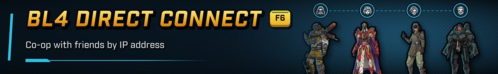

Play with friends without SHiFT matchmaking or Steam invites. One player hosts and friends join by
IP address, all from the **BL4 Direct Connect** page on the MODS screen (press **F6**).

<p align="center">
  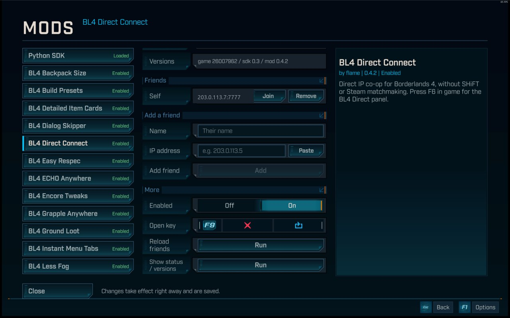
</p>

| Who | What to do |
|---|---|
| **Both** | Add each other: type a name and the other person's public IP, then **Add**. Your own public IP is shown with a **Copy** button (also in the setup app's Co-op page). |
| **Host** | Load into your game and press **Host**. The page shows the address to share and how many friends are connected. |
| **Friend** | From the main menu, press **Join** next to the host's name. |
| **Done** | **Stop hosting** / **Leave game** goes back to normal online play. |

The page also shows a version line (`game <build> / sdk <ver> / mod <ver>`). Both players should
see the same values.

**Smoother enemies for your friends**

In normal co-op, enemies stutter and teleport around on your friends' screens: the host only
sends an enemy's position 4 times a second and lets each friend's game guess the rest, so every
dodge, leap or charge the guess missed snaps the enemy into place. It makes fights as a guest
feel laggy and hard to aim even on a good connection. While you host with friends connected,
BL4 Direct Connect sends enemy positions as often as the game can and gives it more time per
frame to send them. It's one of the biggest improvements to co-op in BL4 Fix:

| Measured on the friend's screen (~11 enemies, 40 ms link) | Game | With BL4 Direct Connect |
|---|---|---|
| Position snaps, per enemy per minute | 3.2 | **1.0** (about 3x fewer) |
| Visible teleports, per enemy per minute | 0.8 | **0.43** (about half) |
| Host frame rate | 46-47 fps | 47 fps (no cost) |
| Host upload per friend | ~9 KB/s | ~17 KB/s |

It's always on, works in SHiFT co-op too, and only the **host** needs it: friends get smoother
enemies without changing anything. Solo or as a guest it does nothing, and the game's own values
come back when the last friend leaves.

**Firewall and ports**

- Only the **host** needs anything opened. Joining is an outgoing connection.
- Over the internet, the host forwards **UDP 7777** on their router to their PC. Friends need
  nothing.
- The setup app's firewall rule blocks UDP 7777 from everyone except your friends (and,
  optionally, your local network or Tailscale). Steam's own rule would otherwise let anyone reach
  it. With the rule on, when you add or remove a friend the F6 page asks whether to update the
  rule (**Continue** / **Not now**); hosting never asks. Continue brings up Windows' prompt for
  **Network Command Shell** (Microsoft Windows): that's `netsh`, Windows' own firewall tool, and
  **Show more details** shows the whole rule.
- The rule only ever blocks; it never opens a port. It's **off until you turn it on**
  (**Firewall rule for hosting** on the Loadout or Co-op page, `BL4FixSetup.exe --firewall on`, or
  the **Firewall** section of the F6 page in game, which also has **Allow local network** and a
  **Status** line saying who gets in).
  Turned off, the setup app removes any rule it added before and never touches your firewall,
  and hosting never asks Windows for permission.
- The setup app runs without admin rights. Windows asks for admin only for the firewall rule, the
  Visual C++ runtime (if it's missing), or a game folder your account can't write to.
- Co-op uses very little bandwidth: about 2-4 KB/s each way in testing, up to ~17 KB/s per friend
  from the host in big fights (smoother enemies, above).

<details>
<summary><b>How it works</b></summary>
<br>

BL4 routes co-op through Gearbox's SHiFT networking (`ShiftNetDriver`). The game also ships
Unreal's `SteamNetDriver`, which talks plain UDP when it's given an IP address instead of a Steam
ID. The mod swaps the game's net driver for that one, then uses Unreal's standard travel commands:
the host reloads their map as a listen server, and friends `open <ip>:<port>`. Stopping hosting or
leaving puts the SHiFT driver back.

It also carries a small message channel between modded players. Mods use it to ask the host's
copy to do things only the host can do (teleporting, rerolls, loot), so they work for every
player in a co-op game.

</details>

### Mod Menu

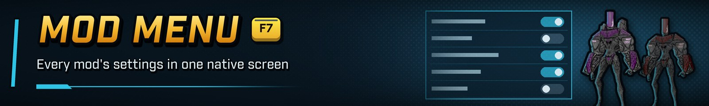

Settings for every mod in one screen that looks like part of the game. Open it with **F7**, or
**MODS** in the pause menu and on the title screen (under Continue). Toggles, sliders and key
bindings use the game's own Options controls, the panel on the right explains whatever you
hover, and changes take effect at once and are saved. Its **Updates** page lists new versions
of your mods (see [Updates](#updates)), and its **Performance** page runs a short benchmark of
what every loaded mod costs per frame (other modders' mods too), so you can find a slow one
yourself.

<p align="center">
  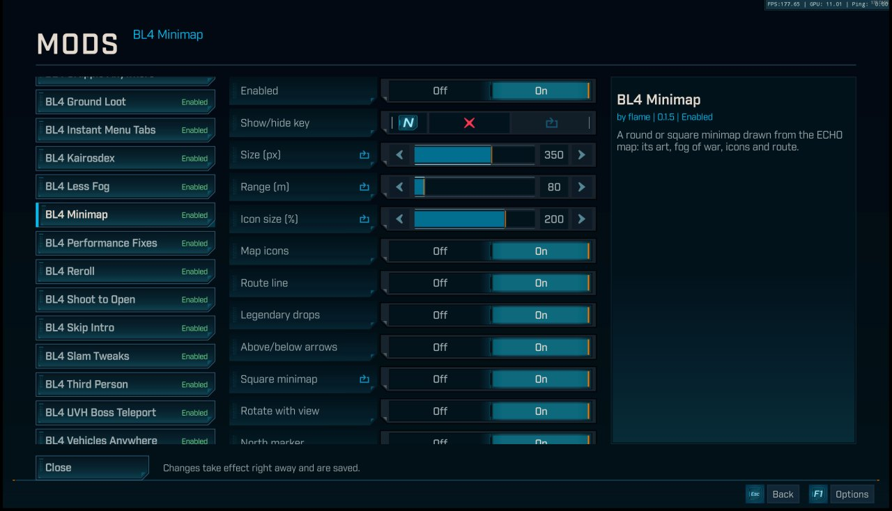
</p>

| The pause menu gets **Mods**, **Kairosdex** and **Carnage Report** | The MODS screen's Updates page |
|:---:|:---:|
| 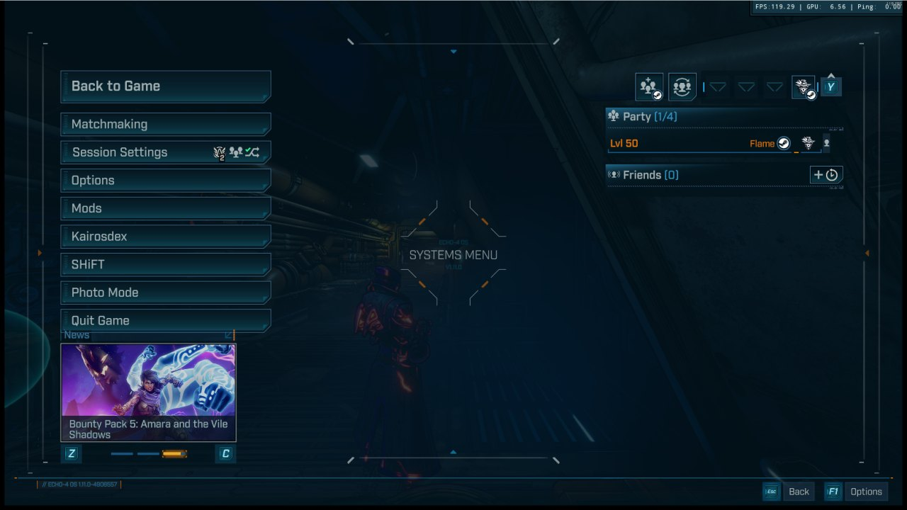 | 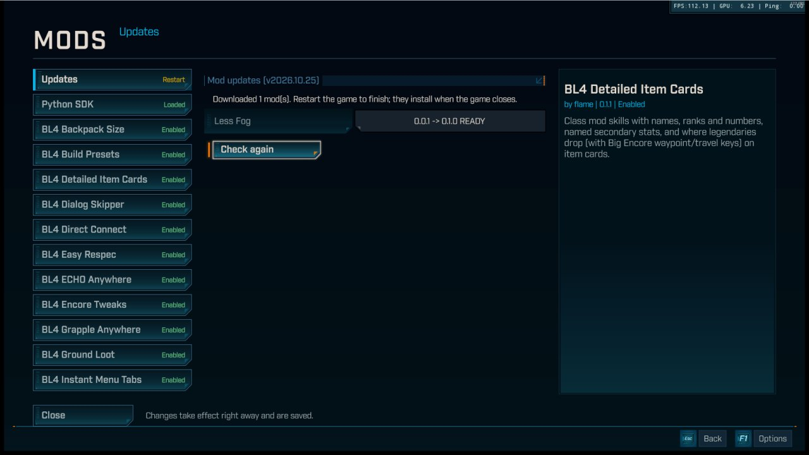 |

### Detailed Item Cards

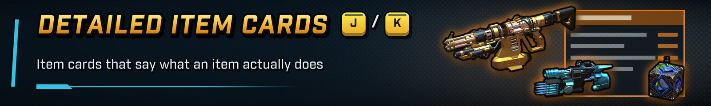

Item cards that tell you what an item actually does.

- **Class mods** list every boosted skill with its name, ranks, numbers and full description,
  coloured by skill tree, instead of only icons and "+2". Skill tooltips show the class mod's
  bonus too ("0/5 [+3 from Class Mod]").
- **Firmware** shows its tiers and numbers.
- **Secondary stats** (the small row, e.g. `35cm`) show their name ("Splash Radius").
- **Banner and red flavour text** render the game's colour markup.
- **Legendaries** show which bosses drop them and how often (normal, UVH, Big Encore), with keys
  to set a waypoint to (**J**) or travel to (**K**) that boss's Moxxi's Big Encore machine.

| A class mod card with its skills and drop source | The skill tree knows about your class mod |
|:---:|:---:|
| 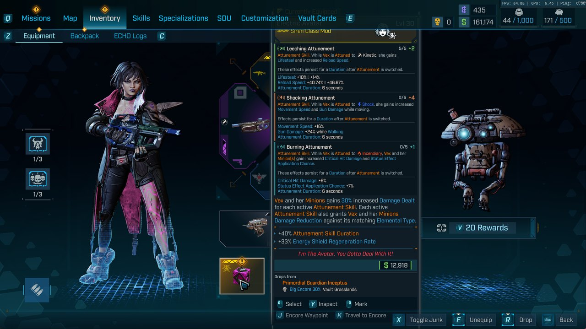 | 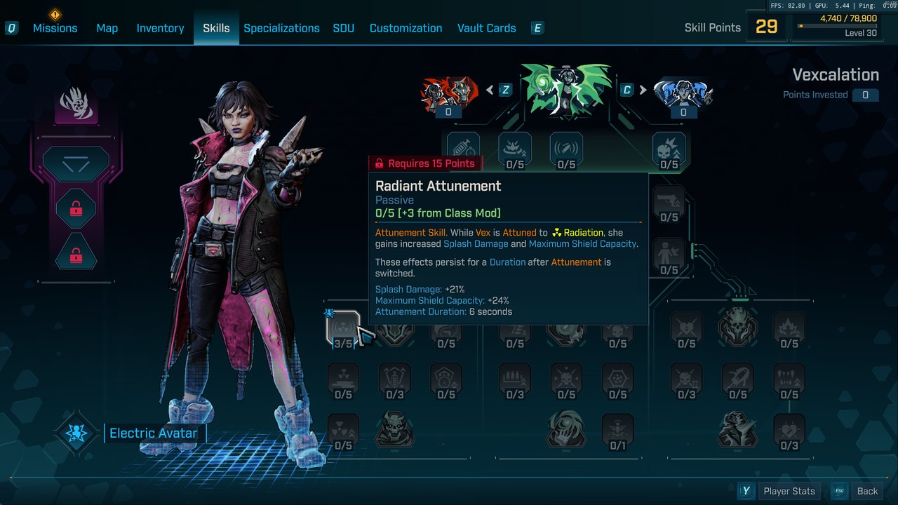 |

### Kairosdex

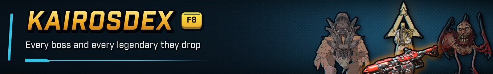

A dex of every boss in the game and the legendaries they drop (**F8**, or **Kairosdex** in the
pause menu): **118 bosses** and **318 legendaries and pearls**, each rendered in game. Search and
sort it, filter by region, kind, item type and maker, and see each item's stats at your level,
re-rolled live. Bosses you've already beaten are filled in from your save (read only), and new
ones are logged as you kill them, in solo or co-op. A HUD banner celebrates your first kill of
each boss and each new legendary.

<p align="center">
  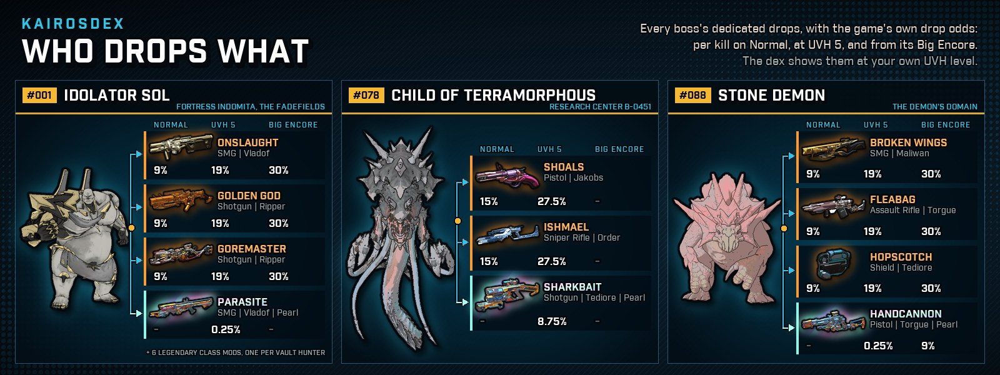
</p>

Every boss's dedicated drops come with the game's own odds: per kill on Normal, at your UVH level
and from its Moxxi's Big Encore machine. Hover a legendary anywhere in the game and its item card
names the bosses too (see [Detailed Item Cards](#detailed-item-cards)).

| Bosses and their drop rates | Items, with stats at your level |
|:---:|:---:|
| 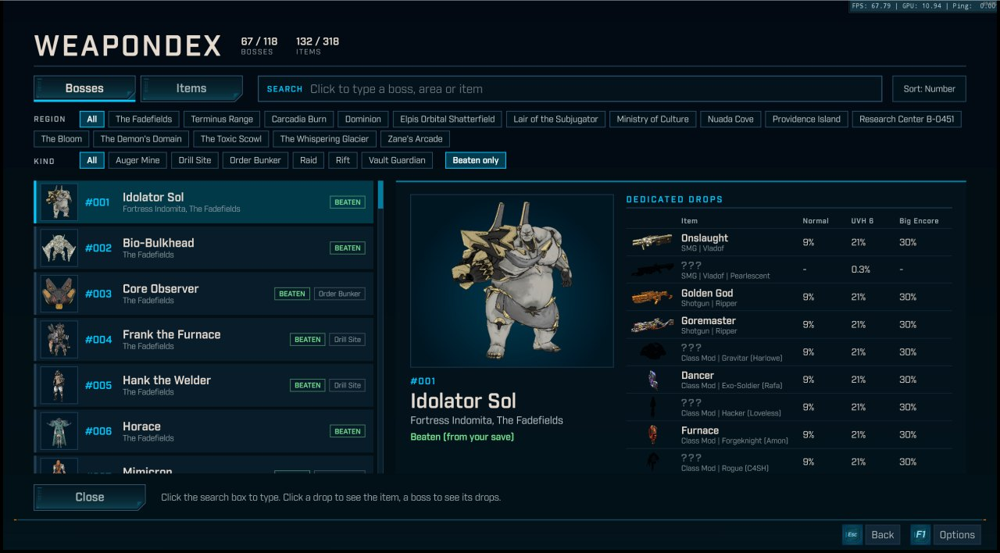 | 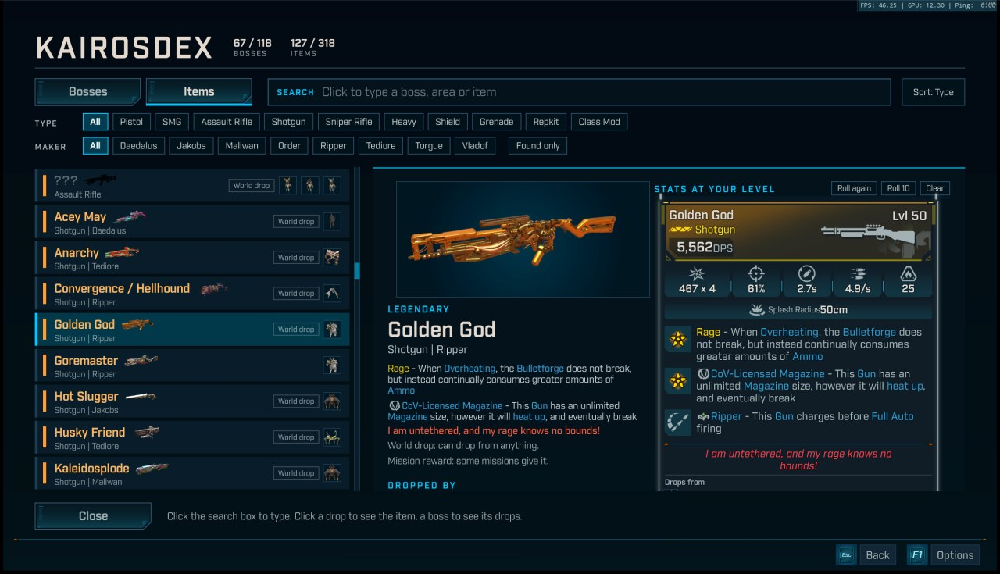 |

<details>
<summary><b>The whole collection</b>: every boss and every legendary and pearl</summary>
<br>

<p align="center">
  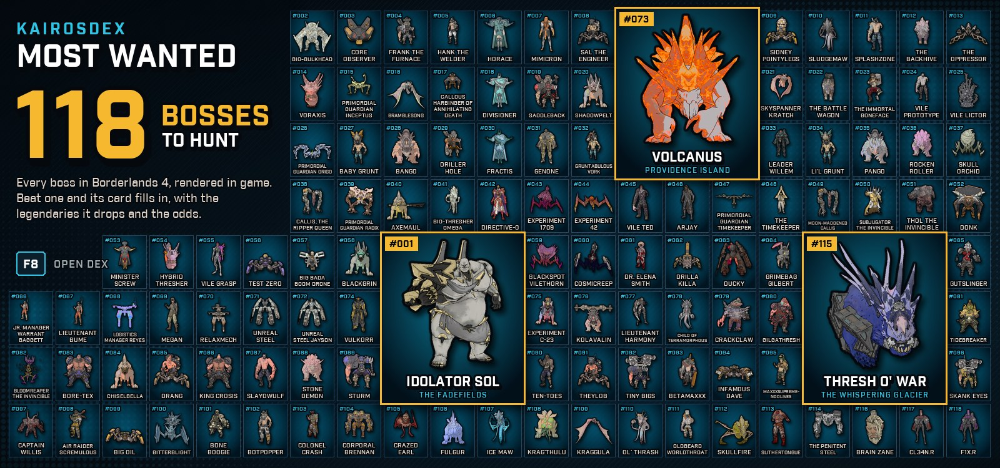
</p>

<p align="center">
  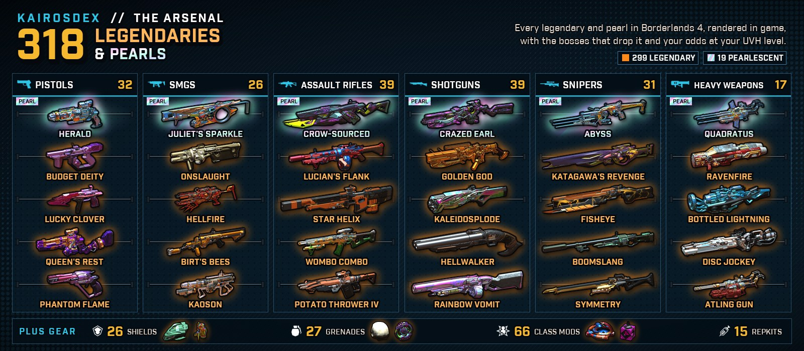
</p>

</details>

<p align="center">
  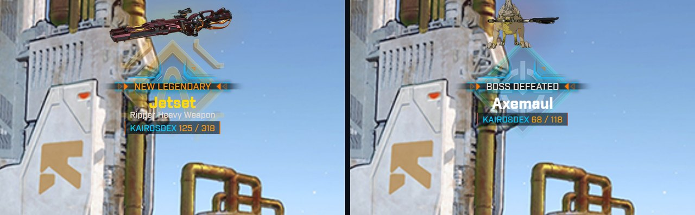
</p>

### Carnage Meter

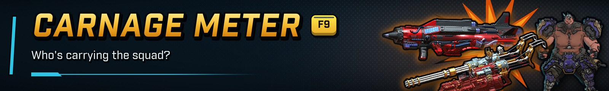

Who's carrying the squad? **F9** (or **Carnage Report** in the pause
menu) shows every player's damage: total, DPS, kills, crit share, biggest hit and share of the
team's damage. It also lists each player's top damage sources by name (that Star Helix, burning,
grenades, skills) and a damage-mix bar. **This Fight** starts over after a lull of a few seconds,
**Session** keeps the whole run, and when a boss dies a results panel names the MVP. In co-op the
host's copy counts everyone's damage, and friends see the same board.

<p align="center">
  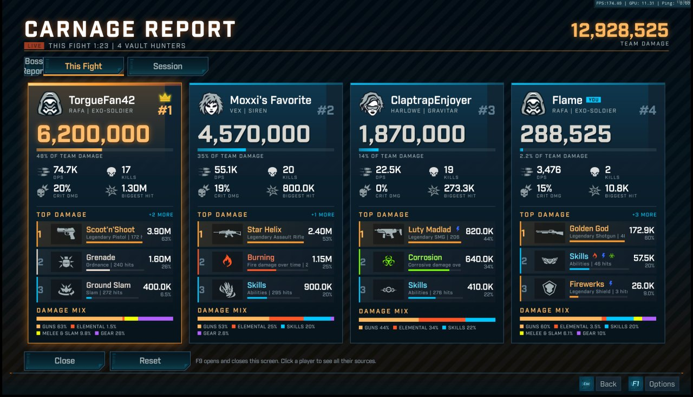
</p>

### Minimap

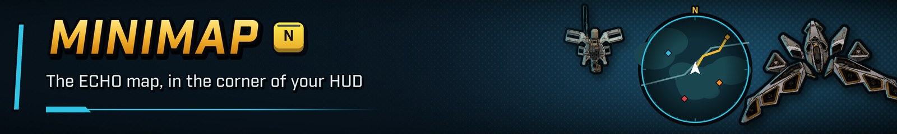

A round or square minimap drawn from the ECHO map itself: its art, fog of war, icons and your
route. **N** shows or hides it. It films the map once and pans across that picture, so it costs
about 0.13 ms a frame.

<p align="center">
  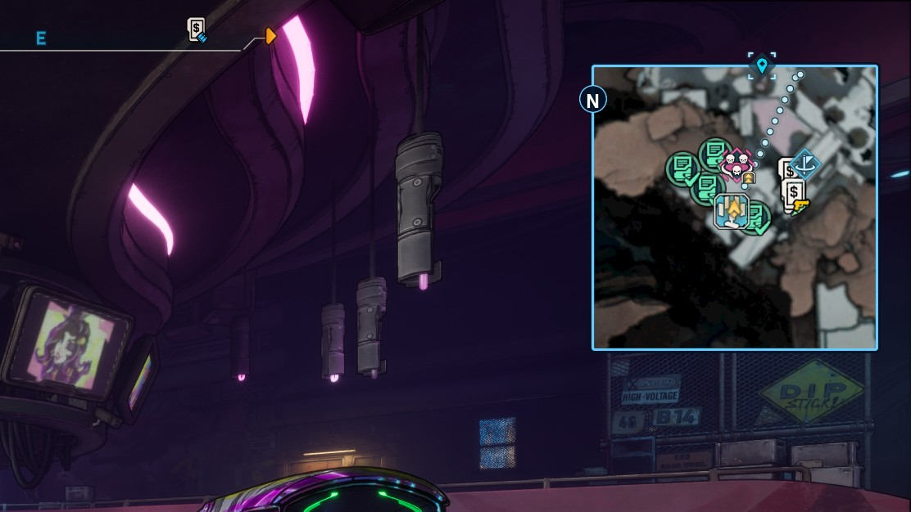
</p>

### Reroll

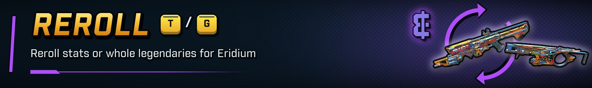

Don't like a stat on a class mod or enhancement? Hover it and press **T** to reroll all its
modifiers or **G** to replace one, for Eridium (25 and 50 by default, changeable in its
settings). On a legendary or pearl, **T** rerolls the whole item (100 Eridium by default): a fresh
roll at its level with the game's own drop odds, so rare parts stay rare. In co-op, the host's copy
does the reroll for you.

<p align="center">
  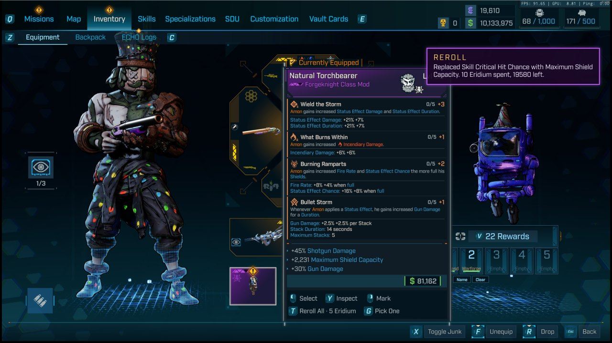
</p>

### Build Presets

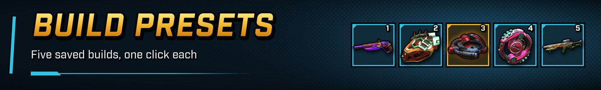

Five build squares in the inventory. Save your equipped gear, skills and specializations into
one with a click, load it back with another, and name each build. You can also bind keys to
load a build, or the next and previous one.

<p align="center">
  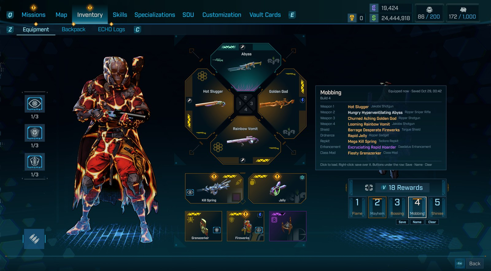
</p>

### Easy Respec

Right-click a skill in the Skills menu to take a point back out, as long as the tree stays
valid. No more full respec to fix one misclick. The menu's button bar shows the new
**Remove Point** hint.

<p align="center">
  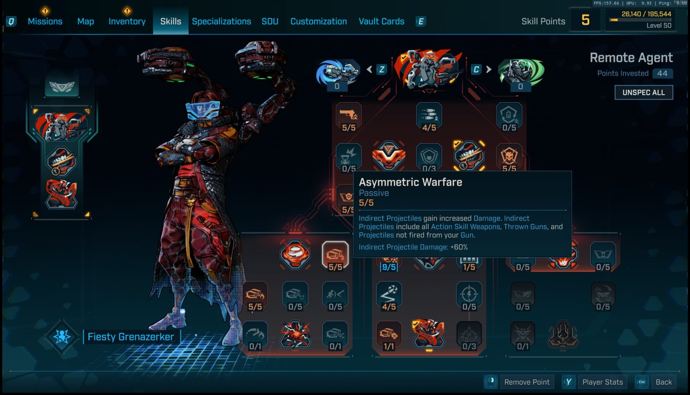
</p>

### Third Person

**H** switches to an over-the-shoulder camera with proper aiming. **K** swaps shoulders.

<p align="center">
  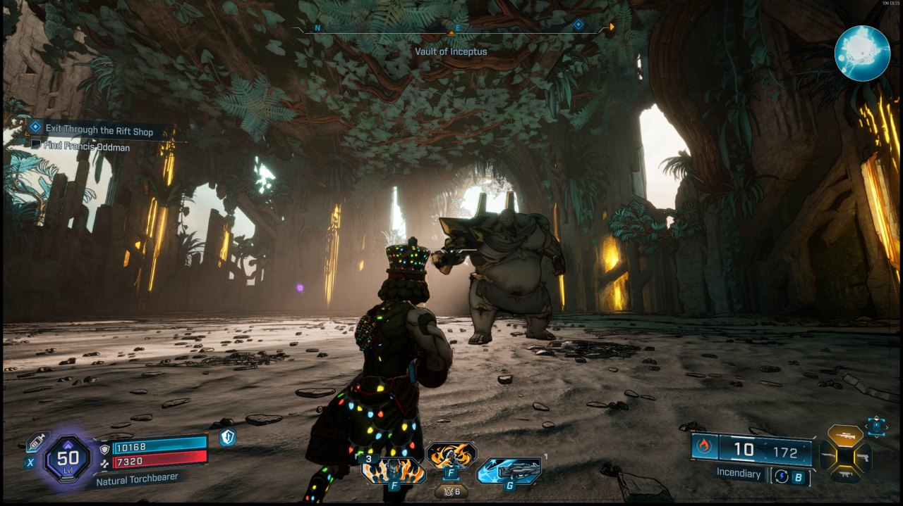
</p>

### Less Fog

Clears the haze over the world, live: **No fog** (the default) or a lighter preset (Light,
Balanced, Clear, Very clear), or set density, start distance and distance haze yourself.
**Vanilla** gives the game's own fog back.

<p align="center">
  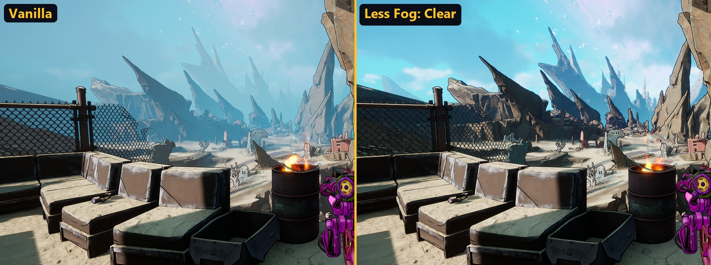
</p>

### And the rest

| Mod | What it does |
|---|---|
| **Instant Item Pictures** | Your items' pictures are ready before you open the backpack, and no longer blink out while you scroll. The game redraws every picture every few minutes; this keeps them and draws missing ones in the background. Optionally the bank too (about 0.5 MB of video memory per item). |
| **Instant Fast Travel** | Fast travel to a station on the same map puts you there at once, without the travel portal. Other maps still load as normal. |
| **Unstuck** | Frees a character left floating after a teleport (can't move, can't fall) and lands it on the nearest fast travel or respawn station, by itself after a few seconds or with **Unstuck now** on MODS. |
| **Save Backups** | Copies every character and your profile (with the bank) each time the game starts, outside the game's save folder. MODS lists the history per character and for the bank. Pick one to restore and it's written right after you quit (the running game would save over it), with your current saves copied aside first so you can undo it (see [Safety](#safety)). |
| **Skip Intro** | No 2K / Gearbox logo movies at launch. Switching it off puts them back. |
| **Instant Menu Tabs** | The ECHO menu opens and switches pages (inventory, skills, map...) at once, without the pause. |
| **ECHO Anywhere** | Open the ECHO menu when the game normally refuses (falling, mid-air...). |
| **Sprint Toggle** | Press once to sprint, again to walk. Unlike the game's own toggle, the sprint picks itself back up after you stop, shoot, aim, slide or jump. Pick any key or controller button (or your sprint key), or turn on Always sprint. |
| **UVH Boss Teleport** | Hover an Ultimate Vault Hunter boss challenge and press **T** to go to its Big Encore machine. |
| **Vehicles Anywhere** | Summon and drive your vehicle where the game says vehicles aren't allowed. |
| **Backpack Size** | Set how many items your backpack, bank and Lost Loot hold. |
| **Shoot to Open** | Shoot a container or chest to open it. |
| **Performance Fixes** | Fewer hitches: Python garbage collection without stalls, cheaper mod hooks, and optionally frame generation kept on in menus. |
| **Tidy Pause Menu** | Moves the pause menu's News panel to the bottom right, under the party list, so it no longer covers Quit Game. Or hide it. |
| **Crisp Damage Numbers** | Sharper damage numbers with DLSS/FSR. Light (default) turns off the blur the game puts over them, at no measurable cost; Full also draws them at your screen's resolution, which costs 1.3-2 ms of GPU time in big fights. |

**Ports of Yeti's mods.** These are our own GPL-3.0 rewrites of [Yeti's BL4 SDK mods](https://github.com/RedxYeti/yeti-bl4-sdk),
following this repo's rules (no per-frame cost, everything restored on disable, options in the
Mod Menu). See [`ported/README.md`](ported/README.md) for what changed.

| Mod | What it does |
|---|---|
| **Dialog Skipper** | Skip voice lines with a key or automatically, and speed the game up (host). |
| **Grapple Anywhere** | Grapple to any ledge or surface you aim at. |
| **Ground Loot Helpers** | Bring the loot lying around to you, or clear it away. |
| **Slam Tweaks** | A fast Pre-Sequel style ground slam without the long animations. |
| **Encore Tweaks** | Big Encore machines refill health, shields, ammo and action skill. |

## Co-op: who needs what

Every mod works whether you host or join. Mods that change things the host controls (items,
loot, positions, damage) do it through the host's copy, so a friend only needs the mod if the
table says so.

| Mod | In co-op |
|---|---|
| Mod Menu, Skip Intro, Less Fog, Instant Menu Tabs, ECHO Anywhere, Third Person, Minimap, Item Cards (cards), Performance Fixes, Tidy Pause Menu, Crisp Damage Numbers, Sprint Toggle, Instant Item Pictures, Save Backups | Local: works for whoever runs it, host or friend. |
| Kairosdex | Local; friends' kills are tracked through the boss health bar. |
| Carnage Meter | The host's copy counts every player's damage; a friend's screen shows the host's board (both need it). |
| Easy Respec | Works for a friend on its own; the host needs nothing. |
| Backpack Size, Encore Tweaks | The host's copy covers every player. |
| Dialog Skipper | The host skips for everyone; a friend skips on their own screen. Game speed: host only. |
| Shoot to Open | The host opens what any player shoots. |
| Vehicles Anywhere | The host and each friend need it. |
| Slam Tweaks | Damage: the host's copy for everyone. Movement and animations: only while everyone runs it. |
| Item Cards travel, UVH Boss Teleport | A friend teleports through the host's BL4 Direct Connect. |
| Instant Fast Travel | The host lands at once; a friend asks the host's copy (both need it), else the normal portal. |
| Unstuck | Freeing works for anyone; the move to a station goes through the host's copy, else the game's own trip to your respawn station. |
| Ground Loot, Build Presets (load), Reroll, Grapple Anywhere | A friend asks the host's copy: both need it. |

## Updates

When the game starts, the Mod Menu asks GitHub once whether newer versions of your mods are out.
Nothing is sent but the request itself, and you can turn it off with "Check for updates at
launch" in the Mod Menu's own settings. When there are updates, **MODS** shows a **!**:

1. Open **MODS** and go to the **Updates** page.
2. Press **Update all**. The new versions download and are checked.
3. They install when the game closes, or press **Restart now** to close the game, install them
   and start it again (Steam).

Mods you didn't install are listed there too, with an **Install** button. New boss and item
pictures for the Kairosdex come with a new `BL4FixSetup.exe` or `BL4Fix-Manual.zip`, and the
Kairosdex downloads any that are missing by itself.

## Safety

BL4 Fix is open source ([GPL-3.0](LICENSE)): everything the mods and the setup app run is in this
repository. The mods are Python files that only run inside Borderlands 4, through the
[bl-sdk Python SDK](https://github.com/bl-sdk/oak2-mod-manager). Outside the game, the only things
left running are small hidden helpers that wait for the game to close to finish a job: install
updates, apply a save restore you asked for.

**Your saves.** No mod writes the game's save files. Kairosdex and Save Backups read decrypted
copies. Save Backups copies your saves at each launch into `Saved/BL4Fix Save Backups/`, next to
the game's `SaveGames/` folder. The one exception is a restore you ask for there: it waits until
the game has closed, copies every current save into a `-before-restore` folder first, then writes
and checks the files.

**What goes online, and when.**
- **Update checks** go to GitHub only, once per launch, and only after you answer Yes to "Check for
  updates automatically?" on the Updates page. Mods download only when you press Update or Install.
- **Kairosdex** downloads its boss and item pictures from BL4 Fix's latest GitHub release if they're
  missing from the game folder.
- **BL4 Direct Connect's page** and the setup app's Co-op page look up your public IP (api.ipify.org,
  else ifconfig.me) to show the address friends join.
- **The setup app** checks GitHub for a newer version when it starts, and downloads Microsoft's
  Visual C++ runtime if yours is missing or too old.
- **Co-op** connects to the IP you join; hosting listens on UDP port 7777 (changeable). The optional
  firewall rule (off on a new install, recommended by the setup app) blocks that port to everyone
  except this PC, your friends' IPs and, if "Allow local network" is on, your local network/VPN.
  Windows asks first ("Network Command Shell"); Uninstall removes it.

Nothing else connects anywhere. The Mod Menu's screen talks to the mod through a server on
`127.0.0.1` (this PC only).

**Updates** are checked before use (size, SHA-256 from the release's `manifest.json`, the mod's
folder and version inside), wait in `sdk_mods/.bl4_updates/` and are moved in by a helper once
every Borderlands 4 process has closed, never under a running game. The setup app updates itself
the same way (size, SHA-256, a valid exe).

**Bug reports** are built on your PC (Report a problem, in game or in the setup app) into
`sdk_mods/.bug_reports/`, and nothing is sent. The zip holds versions, the mod list, errors, logs,
the newest crash summary (no memory dump) and the mods' settings files, but not your friends
list, build presets or save key. Your Windows user and PC name, Steam account and display names,
friends' names, IP addresses, Steam IDs and the crash report's account and machine ids are
masked. Open issue page opens GitHub's form in your browser; you attach the zip yourself.

**Other modders' repositories** (Mod Menu > Repositories, Discover) aren't checked by BL4 Fix. Their
mods are Python programs with the same rights as the game: they can read, change and delete your
files and saves and use the internet. The Mod Menu says so every time you add or edit one. What
it does guard against:
- GitHub only: every repository, download, picture, link and redirect.
- Each repository has its own "Check at launch" switch, off unless you turn it on.
- A repository can't replace BL4 Fix's mods or another repository's, or call itself BL4 Fix.
- Its index is read as plain text, and downloads are checked (size, SHA-256, which every mod must
  list, one mod folder, no odd paths, a size cap).
- Before an install or update, the Mod Menu reads the mod's code (without running it) and tells you
  what it uses: the internet, running programs, native code, the registry, code built at run time.
  For an update it names what's new. It's a hint, not a guarantee: code can hide what it does.
- It remembers which GitHub repository you added. If the same link later points to a different
  one (an account deleted and its name taken by someone else), updates from it are blocked until
  you look and choose Trust again.
- Your saves are backed up (Save Backups, if you have it) before another modder's mod loads.

**If something breaks:**
- Switch the mod off on MODS: it puts back what it changed. After a game patch, mods that depend on
  the game's files step aside on their own.
- Run BL4 Fix Setup and untick the mod, or **System > Uninstall** to remove everything.
- **Roll back:** after an update, MODS > Updates lists the previous version of each updated mod
  with a Roll back button (it reloads at once when it can, else when the game closes).
- **Safe mode** (BL4 Fix Setup > System > Safe mode, or `BL4FixSetup.exe --safe-mode on` with the
  game closed) moves every mod that isn't BL4 Fix's into `sdk_mods/.bl4_safe_mode/`, deleting
  nothing. Turn it off there, or press Restore on MODS > Discover in game, to put them back.
- Save Backups restores a character or the bank from any kept backup, and the `-before-restore`
  copy undoes a restore.

**The setup app** isn't code-signed yet, so Windows SmartScreen may warn about an unknown
publisher. It runs without admin and asks Windows only for the firewall rule, the Visual C++
runtime, or a game folder you can't write to. Its exe carries its name, version and license in
Properties > Details, and it starts through a PyInstaller loader compiled for BL4 Fix (not the
stock one many unrelated programs share, which antivirus programs often flag). If you'd rather not
run it at all, [install from the zip](#install-without-the-setup-app).

#### Checking a download

- **`SHA256SUMS.txt`** on every release lists each file's SHA-256. In PowerShell:
  `Get-FileHash BL4Fix-Manual.zip` (or `BL4FixSetup.exe`) and compare.
- **Built by GitHub from this source:** after each release, GitHub Actions
  ([`verify-release.yml`](.github/workflows/verify-release.yml)) checks out the release's tag,
  rebuilds every `.sdkmod`, the Kairosdex pictures zip and `BL4Fix-Manual.zip`, checks they're
  byte-for-byte the released files, and attests them. With the
  [GitHub CLI](https://cli.github.com/): `gh attestation verify BL4Fix-Manual.zip --repo flameaway/bl4-fix`.
  The setup exe isn't rebuilt there (its window uses the game's own art, which only a PC with the
  game has); the workflow checks it against the signed `manifest.json` instead, and you can build
  it yourself (see [For developers](#for-developers)).
- The in-game updater and the setup app check everything themselves: `manifest.json` is signed by
  BL4 Fix's release key and lists every file's SHA-256.

**Found a security problem?** Please [open an issue](https://github.com/flameaway/bl4-fix/issues).

## FAQ and known limitations

<details>
<summary><b>The game was patched and a mod stopped working.</b></summary>
<br>

That's on purpose. Mods that change the game's menu pages or code check that the game files
are still the version they were built for. After a patch they step aside and the game's own
behaviour comes back, rather than breaking the menus. An updated version will show up on the
Updates page.

</details>

<details>
<summary><b>How do I remove a mod, or everything?</b></summary>
<br>

Switch a mod off on the MODS screen (it restores what it changed), or run **Start menu > BL4
Fix Setup**, untick it and **Apply**. **System > Uninstall** removes every mod BL4 Fix installed
and the firewall rule. Your friends list and mod settings are kept.

</details>

<details>
<summary><b>Co-op limitations</b></summary>
<br>

- Players connected this way aren't in a SHiFT party, so SHiFT-only features may not work.
- The host's map reloads when hosting starts or stops.
- If the host gets signed out of SHiFT mid-session (for example, the same SHiFT account signs in
  elsewhere), the game drops the hosted session.
- Joining your own public IP from inside your own network needs router "hairpin" support. Use
  your LAN IP, or test with a friend.

</details>

<details>
<summary><b>Does it touch my saves?</b></summary>
<br>

Only to read them. The Kairosdex reads a copy of your save to fill in bosses you've already
beaten, Save Backups copies your saves aside at each launch, and mods keep their own settings in
`sdk_mods/settings/`. The one time anything writes your saves is a restore you ask for in Save
Backups: it's applied after the game closes, and the saves it replaces are kept aside first.

</details>

## For developers

Every mod is plain Python running inside the game through the
[bl-sdk Python SDK](https://github.com/bl-sdk/oak2-mod-manager) (unrealsdk 3.2, pyunrealsdk 1.10,
Python 3.14 in game). Menus are the game's own HTML pages (Coherent Gameface). One shared pak, the BL4 UI Link
(`shared/uilink/`), adds a single line to the script every page loads last; that line runs our JS
and CSS from loose files, hooked into the game's widgets at runtime, so no game page is replaced
and almost every change reloads live without restarting the game.

| Path | What |
|---|---|
| [`mods/`](mods) | One folder per mod |
| [`ported/`](ported) | GPL-3.0 rewrites of Yeti's mods |
| [`installer/`](installer) | The setup app: `python installer/build.py` produces `dist/BL4FixSetup.exe`; `catalog.py` lists the mods |
| [`assets/`](assets) | Kairosdex's boss and item pictures (rendered in game), shipped by the setup app |
| [`tools/`](tools) | Generators for game-derived data (`gen_*.py`), NCS parser (our rewrite of monokrome's [`bl4-ncs`](https://github.com/monokrome/bl4)), desktop agent, bridge client, live UI editing, `release.py` |
| [`dev/`](dev) | The bridge mod (run Python on the game thread from outside), hot-reload scripts, reverse-engineering and profiling tools |
| [`docs/`](docs) | Write-ups: co-op fast travel, network performance, game hitches |

### Building the setup app

You need Windows, Python 3.11+ and Borderlands 4 installed. Then run:

```
python installer/build.py
```

It downloads the pinned SDK, packs every mod and builds `dist/BL4FixSetup.exe` with PyInstaller (in
`installer/.venv`). The setup window uses the game's own fonts, menus and art. Those aren't in git, so
the first build reads them out of your game's paks and decompresses them with
[pyooz](https://pypi.org/project/pyooz/) (`tools/gen_setup_ui.py`). Use `BL4_GAME_DIR` if the game
isn't in the default Steam folder. Kairosdex's boss and item pictures are rendered in game, which
takes a long time, so they're kept ready-made in [`assets/`](assets). The first build also compiles
PyInstaller's loader from source, which needs Visual Studio's C++ build tools ("Desktop
development with C++"); without them it warns and uses the stock loader.

`python tools/release.py` builds a whole release in `dist/release/` (the `.sdkmod`s, the setup app,
`BL4Fix-Manual.zip`, the signed `manifest.json`, `SHA256SUMS.txt`). Its files are reproducible:
`python tools/verify_release.py --tag <tag> --release-dir <folder>` rebuilds a downloaded release
from a checkout of its tag and compares them byte for byte (use Python 3.11.4, whose zlib the
releases are built with).

Start with [`BL4_MODDING_GUIDE.md`](BL4_MODDING_GUIDE.md) (the long-form history: networking, runtime UMG,
two-instance testing, the installer).

## Credits

- [bl-sdk](https://github.com/bl-sdk) for unrealsdk, pyunrealsdk and oak2-mod-manager, which all
  of this runs on.
- [Yeti](https://github.com/RedxYeti) for the original mods behind the ports in `ported/`.
- [TitanNav](https://github.com/TitanNav) for
  [2-Player Split-Screen Unlocked](https://github.com/TitanNav/bl4-2player-splitscreen) (GPL-3.0):
  BL4 Direct Connect's fast-travel arrival fix (`mods/bl4_direct/arrival.py`) is adapted from its
  "client ready" setter code.
- [mattmab](https://github.com/mattmab) for
  [MattsBL4ModsMenu](https://github.com/mattmab/MattsBL4ModsMenu) (MIT), the runtime UMG patterns
  behind BL4 Direct Connect's fallback panel (`mods/bl4_direct/ui.py`).
- [nanafy](https://github.com/nanafy) for [bl4-slim](https://github.com/nanafy/bl4-slim) (MIT),
  the idea and methods behind the setup app's Disk Space page (our own implementation).
- [monokrome](https://github.com/monokrome) for [bl4](https://github.com/monokrome/bl4)
  (BSD-2-Clause): `tools/ncs_parse.py`, which reads the game's NCS definition files, is our Python
  rewrite of its `bl4-ncs` parser.
- [Nicnl](https://github.com/Nicnl) for
  [borderlands4-serials](https://github.com/Nicnl/borderlands4-serials) (AGPL-3.0): Reroll's item
  serial decoder (`mods/bl4_reroll/serial.py`) is a Python rewrite of its Go decoder, written from
  its format docs and source; the serial readers and writers in Kairosdex, Carnage Meter and
  Reroll (`itemkey.py`, `serialgen.py`) follow `serial.py`.
- [TheS0m3b0dy](https://www.nexusmods.com/borderlands4/users/5784562) for
  [Less Fog](https://www.nexusmods.com/borderlands4/mods/336), the idea of
  Less Fog. Ours is a separate SDK version (it scales the live fog instead of editing the game's
  fog data in a pak) and shares no code with it.

## License

Copyright (c) 2026 flameaway. [GPL-3.0](LICENSE) (version 3 or, at your option, any later
version): use, change and share the code freely, but anything you share that's built on it must
stay open source under the same license, with its source available. The ports in
[`ported/`](ported) are GPL-3.0 like their originals. Every mod's `.sdkmod` carries the license
text.

Files that come from other people's code keep those authors' notices and licenses (see Credits):

- `mods/bl4_direct/arrival.py`: from TitanNav's split-screen mod, GPL-3.0.
- `mods/bl4_reroll/serial.py`, and `itemkey.py` / `serialgen.py` in Kairosdex, Carnage Meter and
  Reroll: from Nicnl's borderlands4-serials, **AGPL-3.0** ([LICENSE-AGPL](LICENSE-AGPL), shipped in
  those three mods too). GPL-3.0 allows the combination; these files stay AGPL-3.0.
- `mods/bl4_direct/ui.py`: follows mattmab's MattsBL4ModsMenu, MIT (notice in the file).
- `tools/ncs_parse.py`: from monokrome's bl4, BSD-2-Clause (notice in the file).

Borderlands 4 game files and anything generated from them (pages, data, pictures) belong to
Gearbox Software and aren't covered by this license.

BL4 Fix is a fan project, not affiliated with or endorsed by Gearbox Software or 2K. Borderlands
is a trademark of Gearbox Software. Screenshots are from the game with these mods installed.
