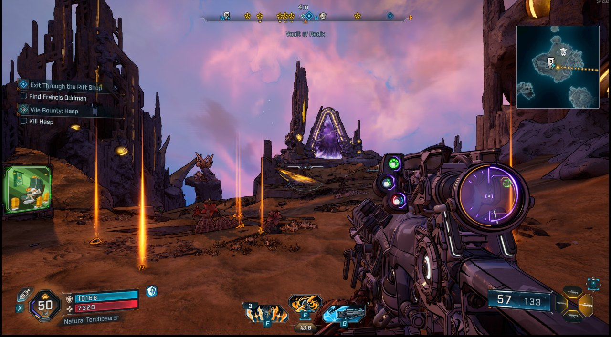
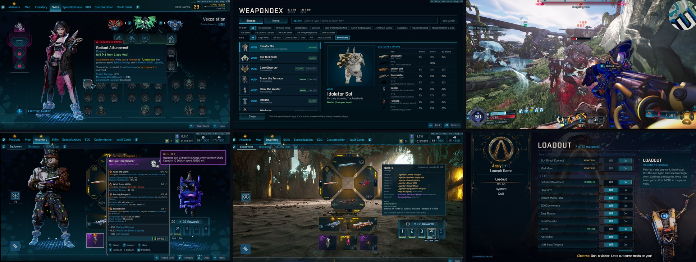

# BL4 Fix

**Direct IP co-op, an in-game mod menu and 20+ quality-of-life mods for Borderlands 4, set up with one installer.**

-orange)

[Install](#install) •
[Mods](#the-mods) •
[Co-op](#bl4-direct-connect-co-op-by-ip) •
[Keys](#keys-at-a-glance) •
[Updates](#updates) •
[FAQ](#faq-and-known-limitations) •
[Development](#for-developers)

---

  

## Why BL4 Fix?

- **Play co-op with friends by IP address.** No SHiFT party or Steam invite needed: one player
  hosts, friends join from an in-game panel.
- **One installer for everything.** It finds your game, installs the Python SDK and the mods you
  tick, sets up the firewall, and prepares every page the mods change before your first launch.
- **Settings inside the game.** Every mod's options and keys are on one **MODS** screen (F7, the
  pause menu or the title screen), built from the game's own menus.
- **Built to cost nothing.** Every mod is held to a strict frame-time budget (no per-frame work
  when it isn't needed, nothing heavy on the game thread). There's even a mod that removes some
  of the game's own hitches.
- **Safe to remove.** Every mod puts back what it changed when you switch it off. The installer
  never writes your save files, and its mods step aside on their own after a game patch until
  they've been updated.
- **Updates itself.** The Mod Menu checks for new versions once per launch and installs them
  when the game closes.

## Install

You need Borderlands 4 on Windows (Steam or Epic). The setup app brings everything else.

1. **[Download `BL4FixSetup.exe`](https://github.com/flameaway/bl4-fix/releases/latest/download/BL4FixSetup.exe)**
   and close Borderlands 4.
2. Run it. It finds your Borderlands 4 install (Steam or Epic).
3. Tick the mods you want (all are ticked on a first install) and press **Apply**.
4. Launch the game. Press **F7**, or pick **MODS** in the pause menu or on the title screen, to
   change any mod's settings and keys.

  

The setup app:

- installs the Microsoft VC++ runtime if it's missing, and the pinned Python SDK
  ([oak2-mod-manager](https://github.com/bl-sdk/oak2-mod-manager) 0.3);
- installs **BL4 Direct Connect** and the **Mod Menu** (always on) plus every mod you ticked,
  already enabled;
- sets up the game pages the mods replace, so item cards, the MODS screen and the co-op page
  work on your first launch;
- adds a Windows Firewall rule so that only friends you've added can reach a game you host;
- adds **Start menu > BL4 Fix Setup**, so you can come back any time to add or remove mods,
  repair, manage friends or uninstall.

<b>More of the setup app</b> (Co-op, System, finished install)

 

| Co-op: your IP, friends and the firewall | System: health check, repair and uninstall |
|:---:|:---:|
|  |  |

Command line: `BL4FixSetup.exe --list-mods`, `--mods <ids>`, `--add-mod <id>`,
`--remove-mod <id>`, `--prepare-pages`.

## Keys at a glance

Every key can be changed on the **MODS** screen. Keys only act while the game window is in front.

| Key | Mod | What it does |
|:---:|---|---|
| **F6** | BL4 Direct Connect | Open the co-op page: host, join, add friends |
| **F7** | Mod Menu | Open the MODS screen (works in game, in menus and on the title screen) |
| **F8** | Kairosdex | Open the boss and legendary dex |
| **F9** | Carnage Meter | Open the Carnage Report: everyone's damage this fight and this session |
| **J / K** | Detailed Item Cards | On a legendary's card: set a waypoint to / travel to its boss's Big Encore machine |
| **T / G** | Reroll | On a class mod or enhancement: reroll all its stats / replace one. On a legendary or pearl: reroll the whole item |
| **T** | UVH Boss Teleport | On a UVH boss challenge: go to its Big Encore machine |
| **H** | Third Person | Switch between first and third person (**K** swaps the shoulder) |
| **N** | Minimap | Show or hide the minimap |
| **Right click** | Easy Respec | On a skill in the Skills menu: take a point back |

## The mods

[Direct Connect](#bl4-direct-connect-co-op-by-ip) •
[Mod Menu](#mod-menu) •
[Item Cards](#detailed-item-cards) •
[Kairosdex](#kairosdex) •
[Carnage Meter](#carnage-meter) •
[Minimap](#minimap) •
[Reroll](#reroll) •
[Build Presets](#build-presets) •
[Easy Respec](#easy-respec) •
[Third Person](#third-person) •
[Less Fog](#less-fog) •
[and the rest](#and-the-rest)

### BL4 Direct Connect: co-op by IP

Play with friends without SHiFT matchmaking or Steam invites. One player hosts and friends join by
IP address, all from the **BL4 Direct Connect** page on the MODS screen (press **F6**).

  

| Who | What to do |
|---|---|
| **Both** | Add each other: type a name and the other person's public IP, then **Add**. Your own public IP is shown with a **Copy** button (also in the setup app's Co-op page). |
| **Host** | Load into your game and press **Host**. The page shows the address to share and how many friends are connected. |
| **Friend** | From the main menu, press **Join** next to the host's name. |
| **Done** | **Stop hosting** / **Leave game** goes back to normal online play. |

The page also shows a version line (`game <build> / sdk <ver> / mod <ver>`). Both players should
see the same values.

**Firewall and ports**

- Only the **host** needs anything opened. Joining is an outgoing connection.
- Over the internet, the host forwards **UDP 7777** on their router to their PC. Friends need
  nothing.
- The setup app's firewall rule blocks UDP 7777 from everyone except your friends (and,
  optionally, your local network or Tailscale). Steam's own rule would otherwise let anyone reach
  it. If you host after changing your friend list, Windows asks once for permission to update
  the rule.
- Co-op uses very little bandwidth: about 2-4 KB/s each way in testing.

<b>How it works</b>

 

BL4 routes co-op through Gearbox's SHiFT networking (`ShiftNetDriver`). The game also ships
Unreal's `SteamNetDriver`, which talks plain UDP when it's given an IP address instead of a Steam
ID. The mod swaps the game's net driver for that one, then uses Unreal's standard travel commands:
the host reloads their map as a listen server, and friends `open <ip>:<port>`. Stopping hosting or
leaving puts the SHiFT driver back.

It also carries a small message channel between modded players. Mods use it to ask the host's
copy to do things only the host can do (teleporting, rerolls, loot), so they work for every
player in a co-op game.

### Mod Menu

Settings for every mod in one screen that looks like part of the game. Open it with **F7**, or
**MODS** in the pause menu and on the title screen (under Continue). Toggles, sliders and key
bindings use the game's own Options controls, the panel on the right explains whatever you
hover, and changes take effect at once and are saved. Its **Updates** page lists new versions
of your mods (see [Updates](#updates)).

  

| The pause menu gets **Mods**, **Kairosdex** and **Carnage Report** | The MODS screen's Updates page |
|:---:|:---:|
|  |  |

### Detailed Item Cards

Item cards that tell you what an item actually does.

- **Class mods** list every boosted skill with its name, ranks, numbers and full description,
  coloured by skill tree, instead of only icons and "+2". Skill tooltips show the class mod's
  bonus too ("0/5 [+3 from Class Mod]").
- **Firmware** shows its tiers and numbers.
- **Secondary stats** (the small row, e.g. `35cm`) show their name ("Splash Radius").
- **Banner and red flavour text** render the game's colour markup.
- **Legendaries** show which bosses drop them and how often (normal, UVH, Big Encore), with keys
  to set a waypoint to (**J**) or travel to (**K**) that boss's Moxxi's Big Encore machine.

| A class mod card with its skills and drop source | The skill tree knows about your class mod |
|:---:|:---:|
|  |  |

### Kairosdex

A dex of every boss in the game and the legendaries they drop (**F8**, or **Kairosdex** in the
pause menu). Search and sort it, filter by region, kind, item type and maker, and see each item's
stats at your level, re-rolled live. Bosses you've already beaten are filled in from your save
(read only), and new ones are logged as you kill them, in solo or co-op. A HUD banner celebrates
your first kill of each boss and each new legendary.

| Bosses and their drop rates | Items, with stats at your level |
|:---:|:---:|
|  |  |

  

### Carnage Meter

*New, still in testing: not in the setup app yet.* Who's carrying the squad? **F9** (or **Carnage Report** in the pause
menu) shows every player's damage: total, DPS, kills, crit share, biggest hit and share of the
team's damage. It also lists each player's top damage sources by name (that Star Helix, burning,
grenades, skills) and a damage-mix bar. **This Fight** starts over after a lull of a few seconds,
**Session** keeps the whole run, and when a boss dies a results panel names the MVP. In co-op the
host's copy counts everyone's damage, and friends see the same board.

  

### Minimap

A round or square minimap drawn from the ECHO map itself: its art, fog of war, icons and your
route. **N** shows or hides it. It films the map once and pans across that picture, so it costs
about 0.13 ms a frame.

  

### Reroll

Don't like a stat on a class mod or enhancement? Hover it and press **T** to reroll all its
modifiers or **G** to replace one, for Eridium (25 and 50 by default, changeable in its
settings). On a legendary or pearl, **T** rerolls the whole item (100 Eridium by default): a fresh
roll at its level with the game's own drop odds, so rare parts stay rare. In co-op, the host's copy
does the reroll for you.

  

### Build Presets

Five build squares in the inventory. Save your equipped gear, skills and specializations into
one with a click, load it back with another, and name each build. You can also bind keys to
load a build, or the next and previous one.

  

### Easy Respec

Right-click a skill in the Skills menu to take a point back out, as long as the tree stays
valid. No more full respec to fix one misclick. The menu's button bar shows the new
**Remove Point** hint.

  

### Third Person

**H** switches to an over-the-shoulder camera with proper aiming. **K** swaps shoulders.

  

### Less Fog

Thins out the haze over the world: lower fog density, pushed further away, adjusted live.

  

### And the rest

| Mod | What it does |
|---|---|
| **Skip Intro** | No 2K / Gearbox logo movies at launch. Switching it off puts them back. |
| **Instant Menu Tabs** | The ECHO menu opens and switches pages (inventory, skills, map...) at once, without the pause. |
| **ECHO Anywhere** | Open the ECHO menu when the game normally refuses (falling, mid-air...). |
| **UVH Boss Teleport** | Hover an Ultimate Vault Hunter boss challenge and press **T** to go to its Big Encore machine. |
| **Vehicles Anywhere** | Summon and drive your vehicle where the game says vehicles aren't allowed. |
| **Backpack Size** | Set how many items your backpack, bank and Lost Loot hold. |
| **Shoot to Open** | Shoot a container or chest to open it. |
| **Performance Fixes** | Fewer hitches: Python garbage collection without stalls, cheaper mod hooks, and optionally frame generation kept on in menus. |
| **Tidy Pause Menu** | Moves the pause menu's News panel to the bottom right, under the party list, so it no longer covers Quit Game. Or hide it. |

**Ports of Yeti's mods.** These are our own GPL-3.0 rewrites of [Yeti's BL4 SDK mods](https://github.com/RedxYeti/yeti-bl4-sdk),
following this repo's rules (no per-frame cost, everything restored on disable, options in the
Mod Menu). See [`ported/README.md`](ported/README.md) for what changed.

| Mod | What it does |
|---|---|
| **Dialog Skipper** | Skip voice lines with a key or automatically, and speed the game up (host). |
| **Grapple Anywhere** | Grapple to any ledge or surface you aim at. |
| **Ground Loot Helpers** | Bring the loot lying around to you, or clear it away. |
| **Slam Tweaks** | A fast Pre-Sequel style ground slam without the long animations. |
| **Encore Tweaks** | Big Encore machines refill health, shields, ammo and action skill. |

## Co-op: who needs what

Every mod works whether you host or join. Mods that change things the host controls (items,
loot, positions, damage) do it through the host's copy, so a friend only needs the mod if the
table says so.

| Mod | In co-op |
|---|---|
| Mod Menu, Skip Intro, Less Fog, Instant Menu Tabs, ECHO Anywhere, Third Person, Minimap, Item Cards (cards), Performance Fixes, Tidy Pause Menu | Local: works for whoever runs it, host or friend. |
| Kairosdex | Local; friends' kills are tracked through the boss health bar. |
| Carnage Meter | The host's copy counts every player's damage; a friend's screen shows the host's board (both need it). |
| Easy Respec | Works for a friend on its own; the host needs nothing. |
| Backpack Size, Encore Tweaks | The host's copy covers every player. |
| Dialog Skipper | The host skips for everyone; a friend skips on their own screen. Game speed: host only. |
| Shoot to Open | The host opens what any player shoots. |
| Vehicles Anywhere | The host and each friend need it. |
| Slam Tweaks | Damage: the host's copy for everyone. Movement and animations: only while everyone runs it. |
| Item Cards travel, UVH Boss Teleport | A friend teleports through the host's BL4 Direct Connect. |
| Ground Loot, Build Presets (load), Reroll, Grapple Anywhere | A friend asks the host's copy: both need it. |

## Updates

When the game starts, the Mod Menu asks GitHub once whether newer versions of your mods are out.
Nothing is sent but the request itself, and you can turn it off with "Check for updates at
launch" in the Mod Menu's own settings. When there are updates, **MODS** shows a **!**:

1. Open **MODS** and go to the **Updates** page.
2. Press **Update all**. The new versions download and are checked.
3. They install when the game closes, or press **Restart now** to close the game, install them
   and start it again (Steam).

Mods you didn't install are listed there too, with an **Install** button. New boss and item
pictures for the Kairosdex come with a new `BL4FixSetup.exe`.

## FAQ and known limitations

<b>The game was patched and a mod stopped working.</b>

 

That's on purpose. Mods that change the game's menu pages or code check that the game files
are still the version they were built for. After a patch they step aside and the game's own
behaviour comes back, rather than breaking the menus. An updated version will show up on the
Updates page.

<b>How do I remove a mod, or everything?</b>

 

Switch a mod off on the MODS screen (it restores what it changed), or run **Start menu > BL4
Fix Setup**, untick it and **Apply**. **System > Uninstall** removes every mod BL4 Fix installed
and the firewall rule. Your friends list and mod settings are kept.

<b>Co-op limitations</b>

 

- Players connected this way aren't in a SHiFT party, so SHiFT-only features may not work.
- The host's map reloads when hosting starts or stops.
- If the host gets signed out of SHiFT mid-session (for example, the same SHiFT account signs in
  elsewhere), the game drops the hosted session.
- Joining your own public IP from inside your own network needs router "hairpin" support. Use
  your LAN IP, or test with a friend.

<b>Does it touch my saves?</b>

 

No. Nothing here writes the game's save files. The Kairosdex reads a copy of your save to fill in
bosses you've already beaten, and mods keep their own settings in `sdk_mods/settings/`.

## For developers

Every mod is plain Python running inside the game through the
[bl-sdk Python SDK](https://github.com/bl-sdk/oak2-mod-manager) (unrealsdk 3.2, pyunrealsdk 1.10,
Python 3.14 in game). Menus are the game's own HTML pages (Coherent Gameface) with thin shims that
load our JS and CSS from loose files, so almost every change reloads live without restarting the
game.

| Path | What |
|---|---|
| [`mods/`](mods) | One folder per mod |
| [`ported/`](ported) | GPL-3.0 rewrites of Yeti's mods |
| [`installer/`](installer) | The setup app: `python installer/build.py` produces `dist/BL4FixSetup.exe`; `catalog.py` lists the mods |
| [`tools/`](tools) | Generators for game-derived data (`gen_*.py`), NCS parser, desktop agent, bridge client, live UI editing, `release.py` |
| [`dev/`](dev) | The bridge mod (run Python on the game thread from outside), hot-reload scripts, reverse-engineering and profiling tools |
| [`docs/`](docs) | Write-ups: co-op fast travel, network performance, game hitches |

Start with [`BL4_MODDING_GUIDE.md`](BL4_MODDING_GUIDE.md) (the long-form history: networking, runtime UMG,
two-instance testing, the installer).

## Credits

- [bl-sdk](https://github.com/bl-sdk) for unrealsdk, pyunrealsdk and oak2-mod-manager, which all
  of this runs on.
- [Yeti](https://github.com/RedxYeti) for the original mods behind the ports in `ported/`.
- The BL4 modding community, whose mods and notes pointed the way.

## License

[MIT](LICENSE): use, change and share the code freely, as long as you keep the copyright notice
and credit. The ports in [`ported/`](ported) are GPL-3.0, like the originals.

BL4 Fix is a fan project, not affiliated with or endorsed by Gearbox Software or 2K. Borderlands
is a trademark of Gearbox Software. Screenshots are from the game with these mods installed.
